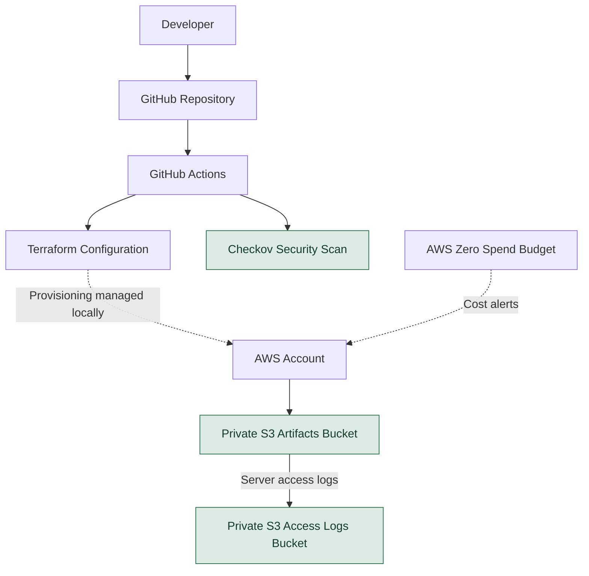

# CloudOps Automation Platform — Architecture

## Security controls

- S3 public access is blocked on both buckets.
- The artifacts bucket uses AWS-managed KMS encryption.
- The access logs bucket uses SSE-S3 encryption.
- Versioning is enabled on both buckets.
- S3 server access logging targets the separate logs bucket.
- GitHub Actions validates Terraform and runs Checkov.
- The CI workflow does not run `terraform apply`.

## Cost controls

An AWS Zero Spend Budget is configured for spending alerts. Budget alerts are not a spending cap, and Cost Explorer data may take time to become available.
